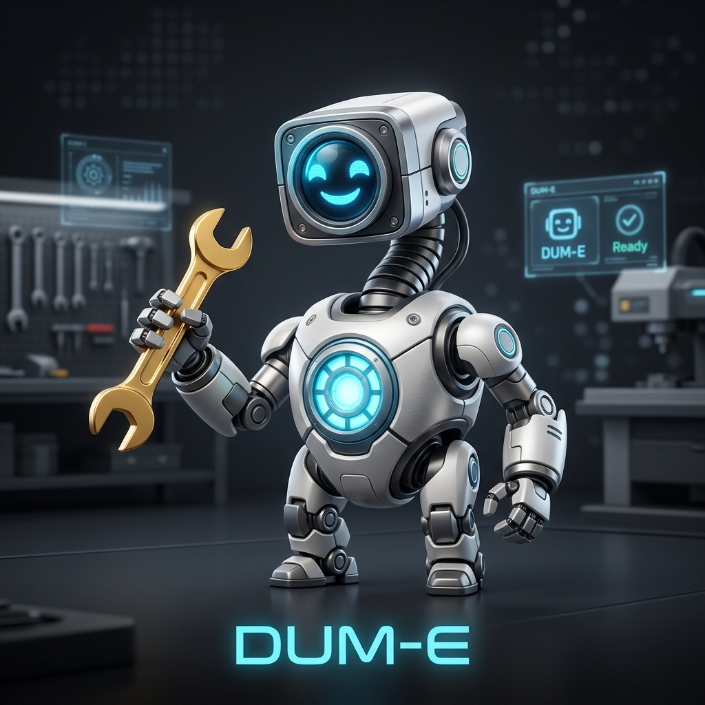
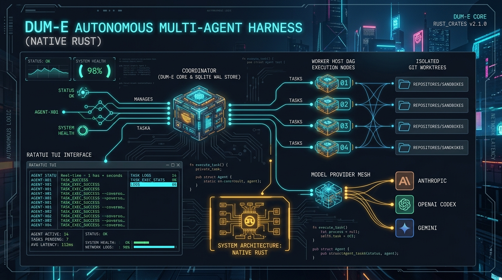
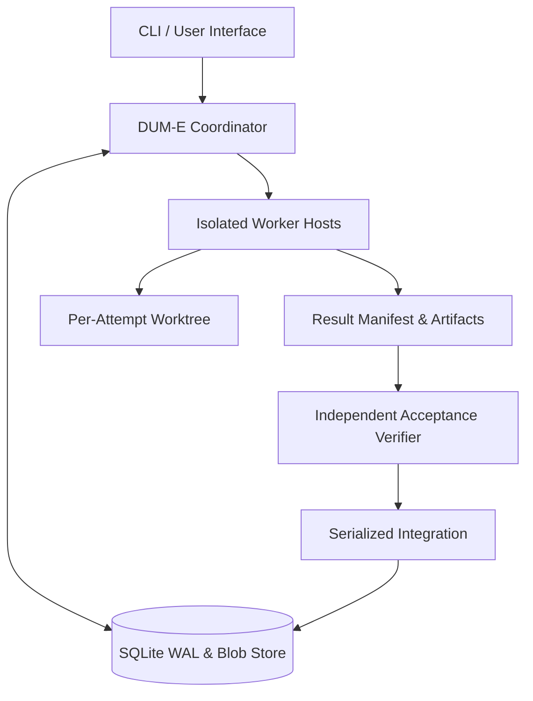

<p align="center">
  
</p>

<h1 align="center">D U M - E</h1>

<p align="center">
  <strong>Clean-Engine Autonomous Multi-Agent Harness (Native Rust)</strong>
  <br/>
  <sub>100% standalone native Rust executable with zero Node.js, Bun, or Python runtime dependencies.</sub>
</p>

<p align="center">
  
  
  
  
</p>

---

## DUM-E Mission

**DUM-E** is an autonomous multi-agent coding harness built from scratch in pure Rust for long-running, fault-tolerant missions:

1. **Zero Legacy Overhead**: Clean Rust modular crates (`dume-core`, `dume-store`, `dume-git`, `dume-worker`, `dume-mcp`, `dume-provider`, `dume-tui`, `dume-cli`).
2. **Native Distribution**: Single standalone binary without Node or Bun runtime dependencies.
3. **Crash & Restart Recovery**: Preserves goals, attempts, and execution logs in an SQLite WAL store (`~/.dume/rust/harness.db`).
4. **Epoch Fencing Guard**: Strictly invalidates stale or zombie worker submissions, preventing race conditions or stale overwrites.
5. **DAG Task Orchestration**: Dynamically schedules multi-agent tasks respecting strict dependency graphs.
6. **Independent Verification**: Worker submissions are never auto-accepted. Independent acceptance criteria and modified path whitelists are verified in detached git worktrees before serialized integration.
7. **Hash-Addressed Blob Storage**: Offloads massive logs and changed blobs to content-addressable storage, avoiding prompt token exhaustion.

---

## Installation & Setup

### Install a Prebuilt Release

Download and run the native installer script:

```bash
curl -fsSL https://raw.githubusercontent.com/jeongminsang/dum-e/main/scripts/install.sh | sh
```

To install a specific version:

```bash
curl -fsSL https://raw.githubusercontent.com/jeongminsang/dum-e/main/scripts/install.sh | sh -s -- --ref v0.1.0
```

The installer verifies `SHA256SUMS` and places the standalone native binary in `~/.local/bin/dume`.

### Build from Source

Requirements: Rust toolchain (`cargo`), Git.

```bash
# Clone repository
git clone https://github.com/jeongminsang/dum-e.git
cd dum-e

# Build release binary (native Rust)
cargo build --release --locked --offline -p dume-cli

# Install binary to PATH
cargo install --locked --offline --path crates/dume-cli
```

Local development build and installation can also be run with:

```bash
sh scripts/install.sh --dev
```

---

## Authentication & Model Configuration

DUM-E supports OAuth (Anthropic, OpenAI Codex) with automatic token refresh, as well as API key authentication:

```bash
# OAuth login
dume login anthropic
dume login openai-codex
dume login openai-codex --device

# API Key login
dume login openai --api-key
dume login google --api-key

# Logout and credential management
dume logout openai-codex
```

API keys can also be supplied via environment variables (`ANTHROPIC_API_KEY`, `OPENAI_API_KEY`, `GEMINI_API_KEY`).

Specify the model provider when launching interactive sessions or checking catalogs:

```bash
# Start interactive TUI session with a specific model
dume interactive --model anthropic/claude-sonnet-4-5
dume interactive --model openai-codex/gpt-5.4

# Query catalog across 39 supported providers
dume models --provider openai-codex
dume models --provider deepseek
```

In the interactive TUI, `/subagents` shows the subagent model setting. Use
`/subagents model <provider/model>` to select a model for newly spawned
subagents, or `/subagents model inherit` to use the parent model. This setting
is stored in `~/.dume/agent/subagents.json`.

---

## CLI Usage

```bash
# 1. Start interactive coding session (DUM-E Ratatui TUI)
dume

# 2. Check DUM-E harness status
dume status

# 3. Start autonomous coordinator with state recovery
dume coordinator --repo-path .

# 4. Run workspace test suite offline
cargo test --workspace --locked --offline
```

## Native Runtime Behavior

### MCP servers

MCP server configuration is JSON in `~/.dume/agent/mcp.json`; project-local
servers go in `<repo>/.dume/mcp.json`. Both files use a top-level `servers`
object. Project entries override same-named global entries unless that global
server is disabled. Project-defined servers require explicit trust before use.
For example:

```json
{
  "servers": {
    "docs": {
      "command": "${HOME}/bin/docs-mcp",
      "args": ["--stdio"],
      "env": {"DOCS_TOKEN": "${DOCS_TOKEN}"},
      "enabled": true,
      "exposure": "deferred",
      "tool_overrides": {"delete_document": "hidden"}
    }
  }
}
```

`exposure` is `direct` (default), `deferred`, or `hidden`; exact tool-name
entries in `tool_overrides` can set the same values for individual tools.
Hidden-only servers are not started. A direct override is declared immediately;
deferred tools become available through `tool_search`. Activation is saved only
after storage succeeds and restored only when configuration and schema match.
`${NAME}` expands from the process environment in command, args, env values,
and cwd; unset variables are errors. Expansion is substitution only, not shell
evaluation. Inspect servers with `dume mcp list` or
`dume mcp list --project <repo>` and trust the current project configuration
with `dume mcp trust --repo <repo>`. Trust records bind the canonical repository
path and that server's SHA-256 digest of its expanded configuration. Editing
the project server configuration changes the digest and requires trust again;
trust is per server and does not grant sandboxing or make a server safe.

### Queued input and durable tool execution

During a busy run, Enter queues a steer for the current run; Ctrl+Q queues a
follow-up for later. Keybindings can be overridden in
`~/.dume/agent/keybindings.json`, for example
`{"bindings":{"Ctrl+q":"SubmitFollowUp"}}`. `/follow-up <text>` also queues
a follow-up. `/queue` or `/queue list` lists pending and paused inputs;
`/queue withdraw <input-id>` withdraws a pending/paused input, and
`/queue resume <input-id>` reactivates a paused one. A failed or restarted run
does not automatically execute paused work. The CLI also exposes
`dume runtime queue list conversation:<id>`, `dume runtime queue withdraw conversation:<id> <input-id>`,
and `dume runtime queue resume conversation:<id> <input-id>`.
Opening a conversation does not resume execution. `/run resume [run-id]`
explicitly resumes an interrupted run; `/queue resume` only reactivates input.

Tool executions and results are durably journaled and saved success or known-failure results
are reused on recovery. A crash while a non-replay-safe tool is running leaves
its outcome as `outcome_unknown`; DUM-E does not blindly dispatch it again.
Inspect a run using `dume runtime inspect <run-id>`. After checking what the
tool actually did, resolve an unknown execution with its current revision and
operator evidence, for example:

```bash
dume runtime resolve <execution-id> --run-id <run-id> --revision <revision> \
  --operator "operator-name" --decision observed_succeeded \
  --evidence "verified external change <reference>"
```

Allowed decisions are `observed_succeeded`, `observed_not_run`, and
`retry_authorized`. Supply `--result <text>` when recording an observed result.
`observed_not_run` requires evidence beginning with `confirmed_not_run:` and a
reliable non-execution reference; a timeout or missing file is not confirmation.
`retry_authorized` may repeat external effects; explicitly acknowledge that
risk with `--acknowledge-duplicate-effect`. Revision checks reject stale
resolutions, and a live executor owning the run prevents resolution. These
controls do not provide exactly-once execution: operators must establish the
external outcome using reliable evidence.

`/session` displays persisted run, model-attempt, and tool timing. Recorded
session totals can be lower bounds after interruption or recovery; incomplete
historical timing is marked lower bound or unknown, not reconstructed duration.
Runs can end in `succeeded`, `failed`, `cancelled`, `interrupted`, or
`needs_attention`; exhausting the worker turn limit is a failure, not a
successful completion.

### Provider retries and program status

Transient provider HTTP/SSE failures retry up to four total attempts with
500 ms, 1 s, then 2 s backoff, subject to a 30 s maximum individual delay and
120 s overall retry window. A provider retry delay may replace the backoff,
within those limits. Failed/provisional attempt usage can remain recorded in
cost totals. Retry clears the failed attempt's provisional text and tool calls;
retry does not
undo external effects. Authentication, invalid-request, and unknown failures
are not automatically retried. OAuth refresh has an independent owner that
keeps the credential lock through token validation and atomic storage. Cancelling
the caller does not cancel an in-progress refresh. Shutdown drains refresh owners
for up to 95 seconds; forced termination cannot guarantee token preservation.

The TUI can emit terminal OSC 7501 program-status messages. `DUME_PROGRAM_STATUS`
accepts `auto` (default), `1` (enable), or `0` (disable); unknown values disable
it. It is always disabled when output is not a TTY, including with `1`. The
status payload uses fixed built-in messages and does not include user prompt or
tool content. The standalone Rust executable does not require Node.js or
Python at runtime.

---

## Architecture

<p align="center">
  
</p>



---

## Project Status & Contributions

This repository is developed and maintained for personal and dedicated internal use. External contributions, issues, and pull requests are not currently accepted.

---

## Acknowledgements

DUM-E's core concepts, protocol design, and architectural foundation originated from and were inspired by [pi](https://github.com/badlogic/pi) by [Mario Zechner](https://github.com/badlogic). DUM-E has since been fully re-architected and rewritten from the ground up as a 100% standalone native Rust engine.

---

## License

DUM-E is licensed under either of:
- Apache License, Version 2.0 ([LICENSE-APACHE](http://www.apache.org/licenses/LICENSE-2.0))
- MIT license ([LICENSE](LICENSE))

at your option.
